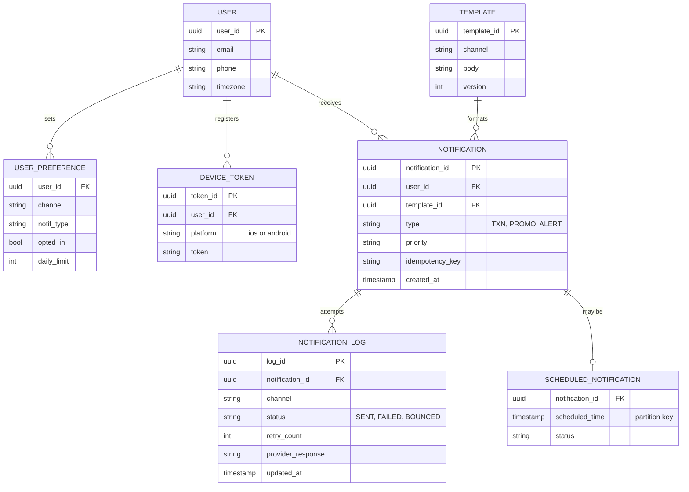
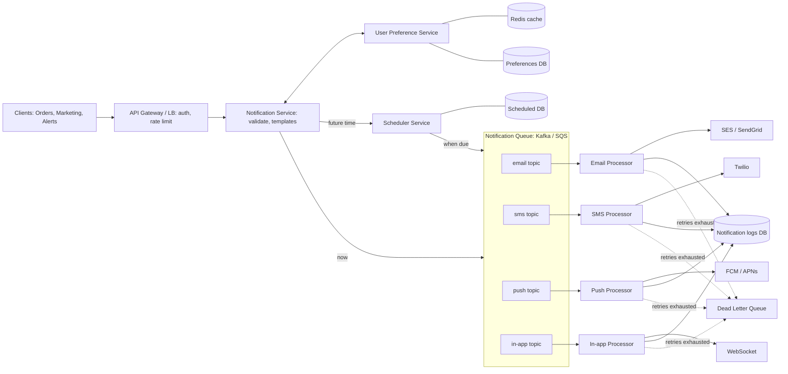
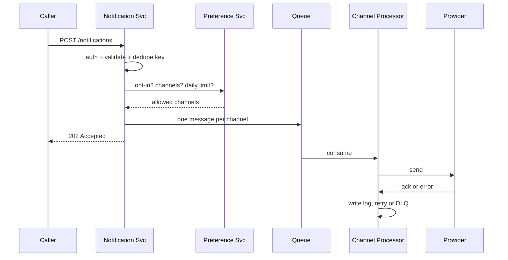
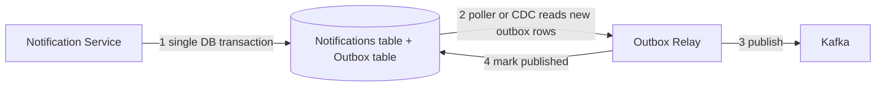
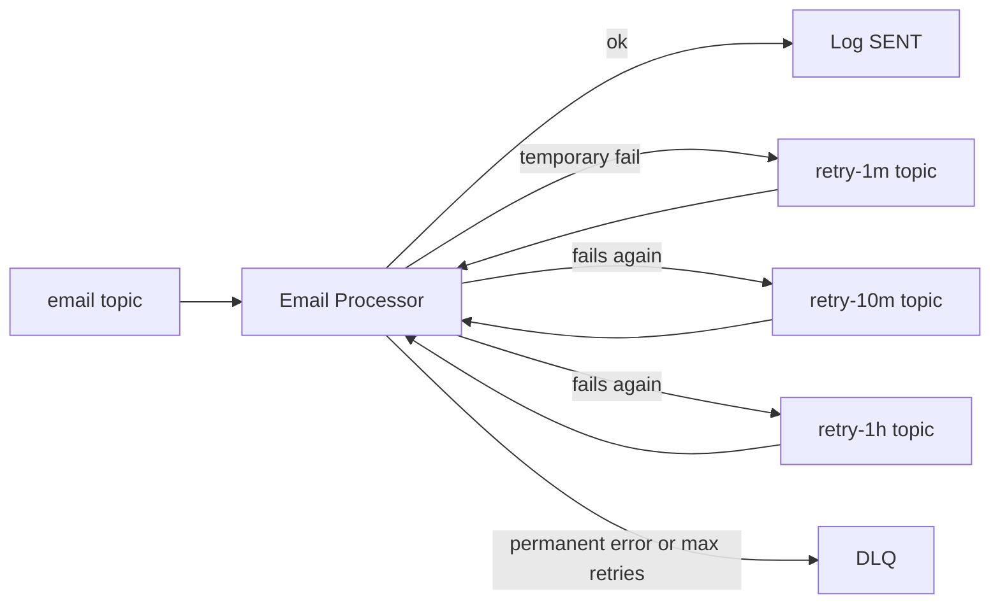
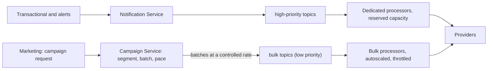

# 🔔 Design a Notification Service

Quick HLD revision guide, ordered the way you'd answer it in an interview. Based on the AlgoMaster chapter.

**Opening line:** "A notification service accepts requests from many internal systems, decides *whether, where and when* to notify a user, and delivers it asynchronously across email, SMS, push and in-app. The queue in the middle is what lets me scale and absorb spikes."

## 1Requirements (2 min)

| Functional | Non-functional |
| --- | --- |
| Multi-channel: email, SMS, push, in-app  Types: transactional, promotional, system alerts  Scheduled (future) delivery  Per-user rate limit on promos (spam control)  Retry on failure | Millions of notifications/min  High availability  At-least-once delivery (exactly-once for select cases)  Low latency for time-critical alerts |

**Say:** "Out of scope: building the email/SMS gateways themselves. I'll integrate third-party providers."

## 2Back-of-envelope

| Item | Math | Result |
| --- | --- | --- |
| Daily volume | 50M users × 5/day | 250M/day |
| Average rate | 250M ÷ 86,400 | \~2.9K/s |
| Peak (flash sale) | 1M in 1 min ÷ 60 | \~17K/s |
| User data | 50M × 1 KB | \~50 GB |
| Notification data | 250M × 1 KB per day | \~250 GB/day |

Takeaway: peak is \~6× average, so buffer with a queue. \~250 GB/day of logs means partition by time and archive.

## 3API sketch

`POST /v1/notifications` → body: `user_id, type, template_id, params, channels[], priority, scheduled_at?, idempotency_key` → `202 Accepted {notification_id}`\
`GET /v1/notifications/{id}` → status per channel\
`PUT /v1/users/{id}/preferences` → opt-in/out, channels, quiet hours

**Say:** "202 because delivery is async. The idempotency key stops duplicate sends when a caller retries."

## 4Entities and ER diagram

### Storage choice per entity

| Data | Store | Why |
| --- | --- | --- |
| Preferences, rate-limit counters | DynamoDB / Mongo + Redis cache | Huge key-value reads by user_id, so cache hot users |
| Notification, logs | PostgreSQL / MySQL | Structured, audit and reporting; partition by time |
| Scheduled notifications | Table partitioned on `scheduled_time` | Query only the next time window |
| Large attachments | S3 (blob) | Keep the queue payload small, send a reference |

## 5High-level architecture

### One-liners per component

- **Notification Service:** entry point; authenticates, validates, checks preferences, renders per-channel messages, enqueues.
- **User Preference Service:** opt-in/out, preferred channels, daily frequency caps.
- **Scheduler Service:** stores future sends and polls every minute or so for due items, then pushes them to the queue.
- **Queue (topic per channel):** decouples ingestion from delivery, so slow SMS providers never block email.
- **Channel Processors:** consumers that call the provider, handle errors, record status.

## 6Request walkthrough

1. Authenticate and validate the request (recipient, type, content, channels).
2. Fetch preferences, then drop opted-out channels and enforce frequency caps.
3. If scheduled, hand off to the Scheduler; otherwise continue.
4. Render the template for each channel (HTML email, truncated SMS, concise push, JSON in-app).
5. Publish one message per channel to its topic (payload, priority, retry count).
6. Processor consumes, sends via provider, waits for ack, logs status.

## 7Deep dives (likely follow-ups)

**Retries.** Temporary failures such as provider downtime are retried with exponential backoff (add jitter). After N attempts the message goes to a Dead Letter Queue for manual review or replay. Permanent errors (invalid number, bounced email, expired device token) skip retries and the token or address gets cleaned up.

**Delivery guarantee and duplicates.** Queue gives at-least-once, so duplicates are possible. Fix: an idempotency key per notification and channel, checked before sending (e.g. Redis `SETNX` or a unique constraint in the log table). Effective exactly-once for critical flows like OTP or payments.

**Rate limiting promos.** Counter per `(user, type, day)` in Redis, with a TTL to the end of the day. Applies only to promotional traffic. Never block transactional or security alerts.

**Priority.** Separate high-priority topics (OTP, password reset) from bulk marketing so a campaign can't delay them.

**Scheduler scale.** Partition by `scheduled_time`, poll the next 1–5 minute window, claim rows with a status flip or lock so two scheduler instances don't double-send.

## 8Scale, reliability, ops

| Concern | Approach |
| --- | --- |
| Horizontal scale | Stateless Notification Service behind an LB; Kafka partitions; processors scaled per channel |
| Sharding | By user_id for user data; time-based partitions for logs |
| Caching | Redis or Memcached for preferences |
| Availability | Multi-AZ replication, multi-region for data, LB health checks |
| Monitoring | ELK or Prometheus/Grafana; success and failure rate, latency, throughput per channel; alert on failure spikes |
| Security | OAuth 2.0, RBAC, gateway rate limiting against abuse |
| Archival | Move old logs to cheap cold storage |

## 9Cheat sheet to recall in 30 seconds

- **Flow:** API → validate → preferences → (scheduler) → render → per-channel queue → processor → provider → log.
- **Why a queue:** absorbs 17K/s peaks, isolates slow providers, enables independent scaling and retries.
- **Why topic per channel:** failure isolation and independent consumer scaling.
- **Guarantee:** at-least-once plus idempotency key.
- **Failure path:** exponential backoff → DLQ.
- **Data:** SQL for logs, NoSQL plus Redis for preferences, S3 for attachments.

## 10SDE2 upgrade: the 4 follow-ups

Format for each: the question, the problem, the answer, the trade-off. Say the trade-off out loud, because that's what SDE2 interviewers listen for.

### A. "What if you crash after the DB write but before publishing to Kafka?"

**Problem:** two systems, no shared transaction. A crash between them loses the notification (or sends a ghost one if you publish first).

- **Answer:** transactional outbox. Write the notification and an outbox row in the same DB transaction. A relay (polling or CDC such as Debezium) publishes to Kafka and marks the row done.
- **Consequence:** the relay can publish twice if it crashes before marking, so consumers must be idempotent (dedupe on notification_id + channel).
- **Trade-off:** extra table and relay latency (ms to low seconds) in exchange for no lost messages. Acceptable here; for OTPs you can also publish directly and fall back to the outbox.

### B. "How do retries work without blocking the queue?"

**Problem:** if a consumer sleeps for backoff, it stalls its whole partition and healthy messages queue behind a failing one (head-of-line blocking).

- **Answer:** retry topics with increasing delay (or SQS delay queues / a delayed-message store). The main consumer never sleeps; it republishes with an incremented `retry_count` and moves on. Add jitter so retries don't arrive in a herd.
- **Classify errors:** temporary (timeout, 5xx, 429) retries; permanent (invalid number, hard bounce, expired token) goes to DLQ right away and triggers cleanup.
- **DLQ:** alert on depth, build a tool to inspect and replay.
- **Trade-off:** more topics to operate, and ordering between messages is lost on retry. Fine for notifications, not for strict sequences.

### C. "Twilio is rate-limiting or down. What happens?"

**Problem:** providers cap your throughput and have outages. Hammering them makes it worse and burns retries.

- **Outbound throttling:** a token bucket per provider account inside the processor, set below the vendor's limit. Consumers slow down and lag builds in Kafka, which is safe backpressure because the queue is the buffer.
- **On 429:** honor `Retry-After`, pause the consumer (Kafka `pause()`), don't burn retry counts.
- **Circuit breaker:** after a failure threshold, open the circuit, stop calling, probe periodically (half-open).
- **Failover:** keep a secondary vendor per channel (e.g. Twilio → Vonage, SES → SendGrid) and route to it when the breaker opens. Keep high-priority traffic on failover first.
- **Delivery receipts:** a 200 from the provider means accepted, not delivered. Handle webhooks (delivered, bounced, complained) and update the log. Track provider message IDs for matching.
- **Trade-off:** failover means two vendor contracts and sender-reputation or number-warmup concerns. Worth it for critical channels such as SMS OTP.

### D. "A 10M-user campaign launches. How do OTPs still arrive on time?"

**Problem:** bulk sends share the same pipe as urgent traffic, and a campaign can fill the queue for hours.

- **Answer:** isolate by priority. Separate topics and consumer groups for high versus bulk, with reserved capacity for high so bulk can't starve it.
- **Fan-out in a Campaign Service:** it resolves the audience, splits into batches (e.g. 10K users), and releases them at a controlled rate instead of enqueueing 10M at once. Also respect each user's timezone and quiet hours.
- **Provider quotas:** a shared account limit still applies, so use separate sender IDs or sub-accounts for marketing versus transactional so a campaign can't exhaust the OTP quota.
- **Trade-off:** campaigns finish slower (paced, not instant) in exchange for protecting critical latency. Autoscale bulk processors on consumer lag.

### Bonus one-liners if they keep digging

| Question | Short answer |
| --- | --- |
| Kafka partition key? | `user_id`, which keeps one user's messages ordered and spreads load. Watch for hot keys from a single mega-account. |
| Provider call succeeded but log write failed? | Unavoidable gap. Dedupe key checked before send narrows it, and a reconciliation job against provider receipts closes it. Accept a rare duplicate over a lost message. |
| Scheduler double-claim? | Claim rows atomically (`UPDATE ... WHERE status='PENDING' ... RETURNING` or `SKIP LOCKED`), and use a lease timeout so rows claimed by a dead instance get re-picked. |
| Missed jobs after scheduler downtime? | Query `scheduled_time <= now` (not an exact window) so overdue rows are caught on recovery. |
| Template changes mid-flight? | Version templates and store the version on the notification so retries render identically. |